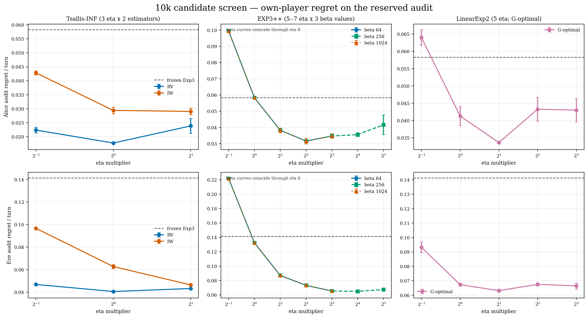
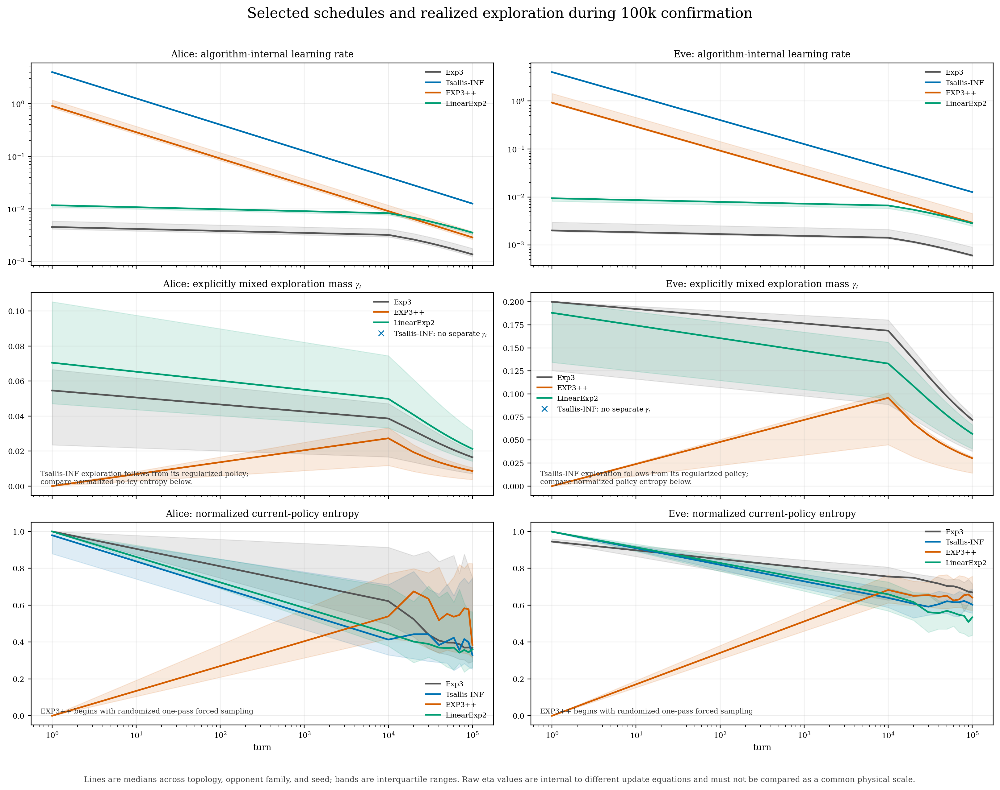
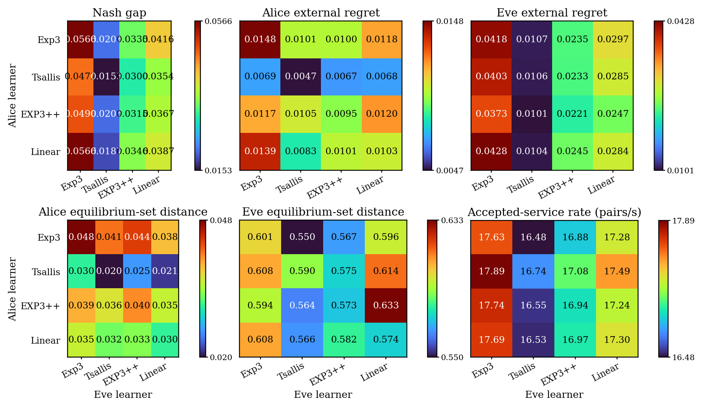
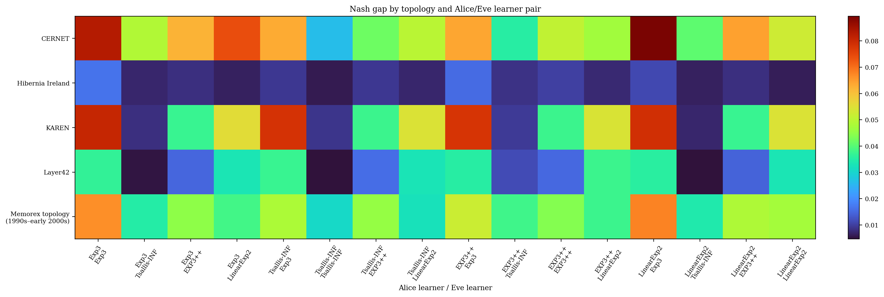
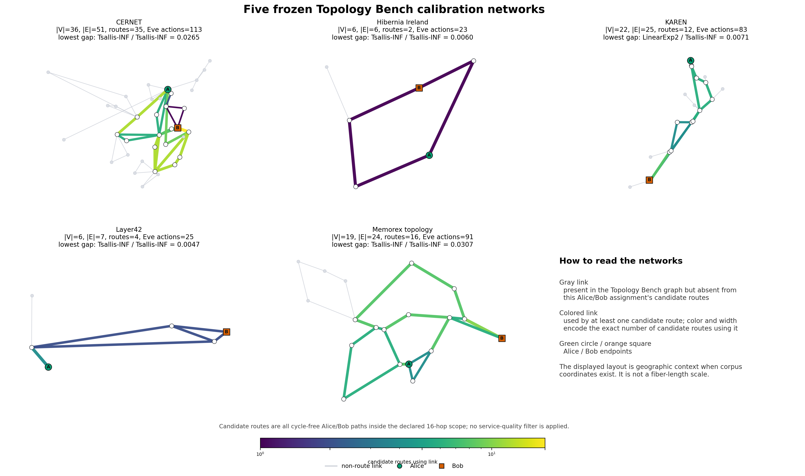
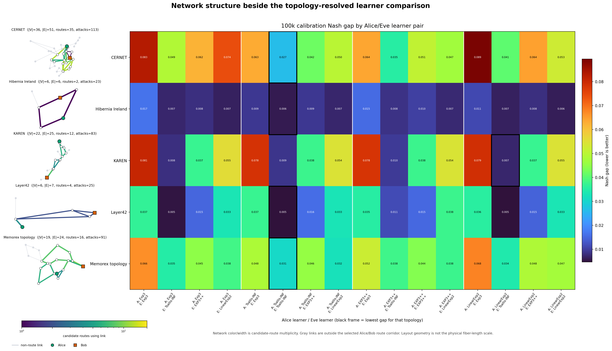
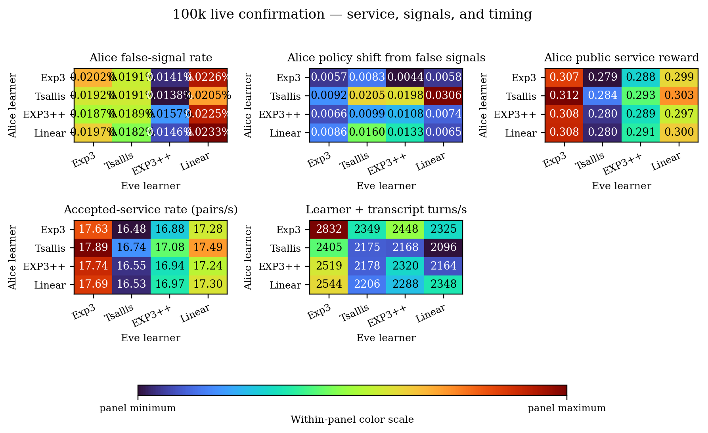
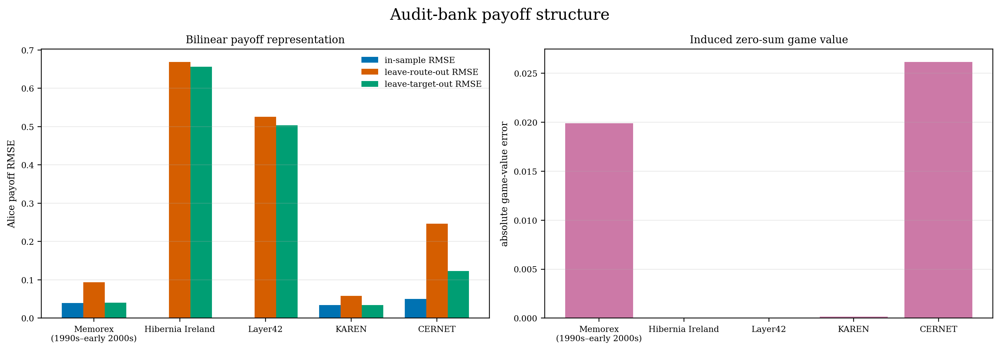

# Step 7 histogram learner calibration report

## Result in one paragraph

On these five calibration topologies, symmetric Tsallis-INF gives the lowest aggregate Nash gap: 0.015303 +/- 0.000370, compared with 0.056616 +/- 0.002288 for Exp3/Exp3. Eve's learner family has the larger main effect: every Alice family paired with Tsallis-INF Eve reaches a lower gap than the corresponding pairing with Exp3 Eve. The finite structured learner is competitive but topology-dependent; its clearest result is KAREN, where LinearExp2 Alice against Tsallis-INF Eve gives the lowest gap. These measurements identify the leading settings in the declared screen, but the asymmetric eta/exploration coverage requires a calibration-only refinement before settings are frozen. They are not evaluation-set estimates.

## Scope and information boundary

The screen contains 3,480 matched 10k-turn runs. The confirmation contains 240 fresh compiled-histogram 100k-turn runs over five fixed calibration topologies and three fresh seeds. The evaluation partition was not loaded. Learners received only their selected action's scalar reward; the reserved audit bank supplied post-run strategic scoring.

## Selected settings

| Player | Family | Selected | Mean own regret/turn | Raw minimum |
|---|---|---|---:|---|
| Alice | Exp3 | `flat_exp3_frozen` | 0.058263 | `flat_exp3_frozen` |
| Alice | Tsallis-INF | `tsallis_rv_eta1` | 0.017735 | `tsallis_rv_eta1` |
| Alice | EXP3++ | `exp3pp_beta256_eta4` | 0.031622 | `exp3pp_beta1024_eta4` |
| Alice | LinearExp2 | `linear_goptimal_eta2` | 0.033643 | `linear_goptimal_eta2` |
| Eve | Exp3 | `flat_exp3_frozen` | 0.141208 | `flat_exp3_frozen` |
| Eve | Tsallis-INF | `tsallis_rv_eta1` | 0.040614 | `tsallis_rv_eta1` |
| Eve | EXP3++ | `exp3pp_beta256_eta8` | 0.065396 | `exp3pp_beta256_eta16` |
| Eve | LinearExp2 | `linear_goptimal_eta2` | 0.063118 | `linear_goptimal_eta2` |

EXP3++ beta values 64, 256, and 1024 were behaviorally identical through eta 8 because the gap-dependent term did not become the active exploration floor. Alice's EXP3++ minimum is interior at eta 4. Eve's raw minimum is eta 16; the declared one-standard-error rule selects eta 8.

Calibration coverage is asymmetric: Tsallis-INF tests three eta multipliers per estimator, LinearExp2 tests five, and EXP3++ tests five per beta plus eta 16/32 at beta 256. The Tsallis-INF IW curve is still improving at eta 2 for both players. Therefore RV/eta 1 is the minimum of the declared Tsallis grid, not evidence that the full Tsallis schedule family has been optimized.

Each eta label is a constant multiplier on a time-dependent schedule, not a constant learning rate. Tsallis-INF decays as 1/sqrt(t). Exp3, EXP3++, and LinearExp2 also use time-dependent rates. Explicit exploration is not independently tuned across all families: Tsallis-INF has no added gamma mixture; EXP3++ beta never becomes active in the tested range; and LinearExp2 fixes the G-optimal design while tying gamma_t to eta_t and the feature rank.

| Family | Learning-rate schedule | Explicit exploration |
|---|---|---|
| Exp3 | `c sqrt(log(K_eff)/(K_eff (t+t0)))` | `gamma_t=min(0.2, K_eff eta_t)` |
| Tsallis-INF RV/IW | `4c/sqrt(t)` / `2c/sqrt(t)` | none; exploration follows from the Tsallis-regularized policy |
| EXP3++ | `0.5c sqrt(log(K)/(tK))` | per-arm `min(1/(2K), base_eta_t, beta log(t)/(t gap_lcb_t(a)^2))` |
| LinearExp2 | `c sqrt(log(K)/(d (t+t0)))` | `gamma_t=min(0.2, d eta_t)` mixed through the G-optimal design |

Here `K_eff` is the inverse minimum exploration-prior mass and `d` is the feature rank. These predictable schedules remain relevant to a Stackelberg prime-and-probe attack: time variation creates distinct probing, concentration, and reduced-exploration windows; it does not remove them.

## Two-sided 100k confirmation

Each cell below averages five topologies and three fresh seeds. The uncertainties are standard errors over matched seed blocks, not over individual turns.

| Alice | Eve | Alice regret/turn | Eve regret/turn | Nash gap | Alice equilibrium-set TV | Eve equilibrium-set TV |
|---|---|---:|---:|---:|---:|---:|
| Exp3 | Exp3 | 0.014832 | 0.041784 | 0.056616 +/- 0.002288 | 0.047862 | 0.601218 |
| Exp3 | Tsallis-INF | 0.010075 | 0.010734 | 0.020809 +/- 0.000312 | 0.041303 | 0.550169 |
| Exp3 | EXP3++ | 0.010041 | 0.023475 | 0.033517 +/- 0.000486 | 0.043628 | 0.567296 |
| Exp3 | LinearExp2 | 0.011818 | 0.029746 | 0.041564 +/- 0.002324 | 0.038226 | 0.596438 |
| Tsallis-INF | Exp3 | 0.006879 | 0.040321 | 0.047201 +/- 0.000298 | 0.030208 | 0.607828 |
| Tsallis-INF | Tsallis-INF | 0.004709 | 0.010594 | 0.015303 +/- 0.000370 | 0.019787 | 0.590101 |
| Tsallis-INF | EXP3++ | 0.006724 | 0.023275 | 0.029999 +/- 0.000798 | 0.025291 | 0.574632 |
| Tsallis-INF | LinearExp2 | 0.006828 | 0.028531 | 0.035359 +/- 0.001161 | 0.021218 | 0.614243 |
| EXP3++ | Exp3 | 0.011674 | 0.037291 | 0.048966 +/- 0.000921 | 0.038917 | 0.594344 |
| EXP3++ | Tsallis-INF | 0.010453 | 0.010113 | 0.020566 +/- 0.001068 | 0.036159 | 0.563738 |
| EXP3++ | EXP3++ | 0.009458 | 0.022052 | 0.031510 +/- 0.000429 | 0.040340 | 0.572603 |
| EXP3++ | LinearExp2 | 0.011987 | 0.024713 | 0.036700 +/- 0.001199 | 0.035171 | 0.633368 |
| LinearExp2 | Exp3 | 0.013852 | 0.042787 | 0.056639 +/- 0.000988 | 0.035350 | 0.608142 |
| LinearExp2 | Tsallis-INF | 0.008254 | 0.010409 | 0.018663 +/- 0.000441 | 0.032197 | 0.565888 |
| LinearExp2 | EXP3++ | 0.010136 | 0.024473 | 0.034609 +/- 0.002574 | 0.032767 | 0.581536 |
| LinearExp2 | LinearExp2 | 0.010334 | 0.028397 | 0.038731 +/- 0.000916 | 0.030424 | 0.574451 |

The Nash gap is the sum of Alice's and Eve's audit-bank best-response gaps. It measures exploitability of the learned pair. External regret instead scores each realized opponent sequence, so the two diagnostics need not order learner pairs identically.

Eve's equilibrium-set total-variation distance remains between 0.55 and 0.63 even in low-regret cells. Therefore the confirmation supports low exploitability at 100k turns, not convergence to a particular equilibrium marginal. Redundant and nearly equivalent attack actions make distributional convergence a stricter demand.

## Learner-family main effects

These are descriptive averages over all four opposing learner families. They do not remove interaction effects.

| Alice family | Mean Alice regret/turn | Mean Nash gap |
|---|---:|---:|
| Exp3 | 0.011691 | 0.038126 |
| Tsallis-INF | 0.006285 | 0.031965 |
| EXP3++ | 0.010893 | 0.034435 |
| LinearExp2 | 0.010644 | 0.037161 |

| Eve family | Mean Eve regret/turn | Mean Nash gap |
|---|---:|---:|
| Exp3 | 0.040546 | 0.052355 |
| Tsallis-INF | 0.010463 | 0.018835 |
| EXP3++ | 0.023319 | 0.032409 |
| LinearExp2 | 0.027847 | 0.038088 |

Tsallis-INF has the lowest own-player regret in both roles. The structured LinearExp2 learner improves on Exp3 in the role-averaged comparison, but it is not uniformly best. This is evidence for retaining both independent-arm and structured families rather than declaring one universal winner.

## Topology dependence

| Topology | Routes | Eve actions | Best Alice/Eve pair | Best gap | Exp3/Exp3 gap | Reduction from Exp3/Exp3 |
|---|---:|---:|---|---:|---:|---:|
| CERNET | 35 | 113 | Tsallis-INF / Tsallis-INF | 0.026500 | 0.082866 | 68.0% |
| Hibernia Ireland | 2 | 23 | Tsallis-INF / Tsallis-INF | 0.005982 | 0.016521 | 63.8% |
| KAREN | 12 | 83 | LinearExp2 / Tsallis-INF | 0.007108 | 0.080551 | 91.2% |
| Layer42 | 4 | 25 | Tsallis-INF / Tsallis-INF | 0.004669 | 0.036740 | 87.3% |
| Memorex topology (1990s–early 2000s) | 16 | 91 | Tsallis-INF / Tsallis-INF | 0.030710 | 0.066402 | 53.8% |

KAREN is the clearest structured-Alice case: LinearExp2 Alice with Tsallis-INF Eve reaches a gap of 0.007108, compared with 0.080551 for Exp3/Exp3. Hibernia has only two routes; many learner pairs are already close in strategic value, so it provides little evidence for or against a high-dimensional representation.

## Public signals, counterfactual attribution, and timing

Across the 16 family pairs, the mean false-signal rate ranges from 0.0138% to 0.0233%; the associated counterfactual Alice-policy total variation ranges from 0.004356 to 0.030555.

The policy attribution holds selected actions and their factual sampling probabilities fixed, replaces false-signal rewards by their latent-threshold corrections, and replays Alice's estimator updates. It measures the policy displacement caused by those observations on the realized trajectory; it does not simulate the recursively changed actions of a second learning history.

The separate uncontended timing tranche measures 10k-turn learner-plus-transcript throughput. Exp3/Exp3 reaches 2832 turns/s; Tsallis-INF/Tsallis-INF reaches 2175 turns/s. Strategic worker wall time is excluded from this comparison because those runs share CPU and memory bandwidth.

## Payoff-structure audit

For route feature matrix `X`, Eve feature matrix `Z`, and audit payoff matrix `U`, the bilinear model is `U_hat = X W Z^T`. The minimum-Frobenius-norm least-squares coefficient is `W* = X^+ U (Z^T)^+`, where `+` denotes the Moore--Penrose pseudoinverse. Numerical rank is determined by truncated SVD with the explicit cutoff `sqrt(machine epsilon) * largest singular value`; the inverse is therefore the Moore--Penrose inverse of the retained effective-rank matrix. This cutoff prevents numerically null directions in held-out folds from amplifying bounded payoffs.

| Topology | In-sample RMSE | Leave-route-out RMSE | Leave-target-out RMSE | Game-value absolute error |
|---|---:|---:|---:|---:|
| Memorex topology (1990s–early 2000s) | 0.039577 | 0.094078 | 0.040000 | 0.019888 |
| Hibernia Ireland | 0.000046 | 0.668780 | 0.656336 | 0.000012 |
| Layer42 | 0.001131 | 0.525901 | 0.503088 | 0.000000 |
| KAREN | 0.033882 | 0.058050 | 0.034065 | 0.000140 |
| CERNET | 0.050051 | 0.246237 | 0.122551 | 0.026165 |

KAREN and Memorex retain low held-axis errors, so the declared route and Eve features represent their payoff variation beyond the fitted cells. Hibernia and Layer42 fit almost exactly in-sample but have large held-route and held-target errors; their small route sets do not identify the missing feature directions. CERNET is intermediate. Game-value error is reported separately because modest entrywise error can still move the strategically relevant saddle value.

## Claim boundary and next decision

This bundle establishes declared-grid settings and calibration-set comparisons for four symmetric two-player learner families. It does not estimate performance on the five frozen evaluation topologies, establish equilibrium-marginal convergence, or establish that the bilinear feature model transfers to every Topology Bench graph. The next controlled step is to refine eta and exploration on the same calibration partition, freeze the resulting settings, and only then run one 4-by-4 comparison on the evaluation partition with the same regret, exploitability, equilibrium-set, signal, service, and timing diagnostics.

The CSV tables retain every family-pair and topology mean used in this report.
