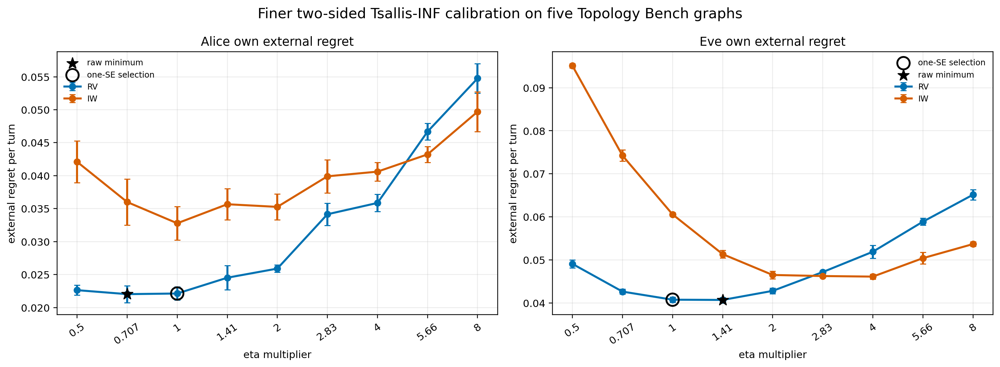
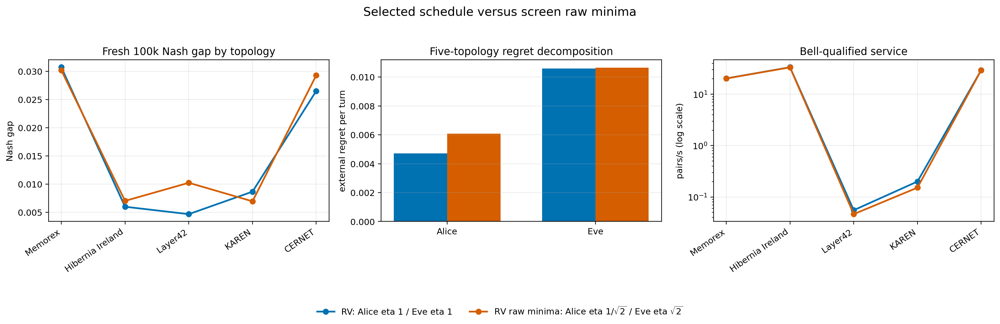
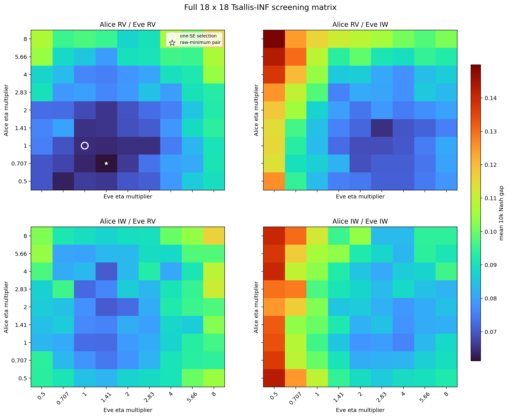
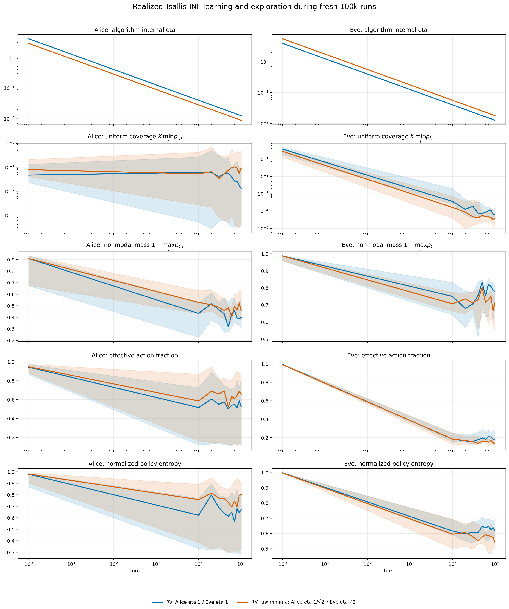

# Five-topology Tsallis-INF refinement

Status: complete
Updated: 2026-07-15

## Result

The complete 18-by-18 two-sided screen retains reduced-variance Tsallis-INF at eta multiplier 1 for both Alice and Eve under the declared one-standard-error rule. Alice's raw screen minimum is RV eta `0.707107`; Eve's is RV eta `1.41421`. The raw minima are close to eta 1 in the 10k bank screen, but their paired fresh 100k combination has Nash gap `0.016730`, versus `0.015303` for RV1/RV1.

The paired raw-minus-selected Nash-gap difference is `0.001427` with a three-seed 95% interval of `[-0.000930, 0.003783]`. The interval is wide with three seeds, but the fresh point estimate does not support replacing the conservative selection with the raw screen minima.

## Calibration design

The screen contains `4,860` 10k-turn games on the five frozen calibration graphs. Both roles cross RV and IW with eta multipliers `0.5, 0.7071, 1, 1.4142, 2, 2.8284, 4, 5.6569, 8`. Selection minimizes the role's own external regret after equal macro-averaging across cases and all opposing settings. The five evaluation graphs remain unloaded.

Alice's one-standard-error eligible set is `tsallis_rv_eta0.5, tsallis_rv_eta0.707107, tsallis_rv_eta1`. Eve's is `tsallis_rv_eta1, tsallis_rv_eta1.41421`. Neither overall eligible set contains IW. IW has an interior minimum for both roles in this full two-sided screen, resolving the earlier eta-2 boundary observed against the smaller opponent-anchor set.

## Realized exploration

The confirmation checkpoints now measure Tsallis exploration directly from each realized policy. `K min_i p_i` is the maximum uniform component contained in the policy; `1-max_i p_i` measures mass outside the modal action; entropy and effective action fraction capture broader support. These values are diagnostics and do not enter either learner's updates.

Reducing Alice's eta to `0.707107` yields visibly broader Alice coverage, while increasing Eve's eta to `1.41421` yields a more concentrated Eve policy. This confirms that the eta changes have the expected policy-level effect even though the combined raw-minimum pair does not improve the fresh aggregate Nash gap.

## Reproducibility and claim boundary

The selected RV1/RV1 confirmation uses the same five cases and seeds as the preceding Step 7 run. All 15 matched rows reproduce Alice reward, Eve reward, Bell-qualified rate, both regrets, Nash gap, false-signal rate, policy-attribution distance, and both empirical strategies exactly. The maximum checked absolute difference is `0.0`. The new telemetry therefore did not alter learning behavior.

The selected pair runs at a mean uncontended `2158` turns/s across the five topologies. This is a calibration result, not an evaluation-partition estimate or a claim of a unique globally optimal eta. The appropriate frozen setting for the evaluation pass is RV eta 1 for both roles.
